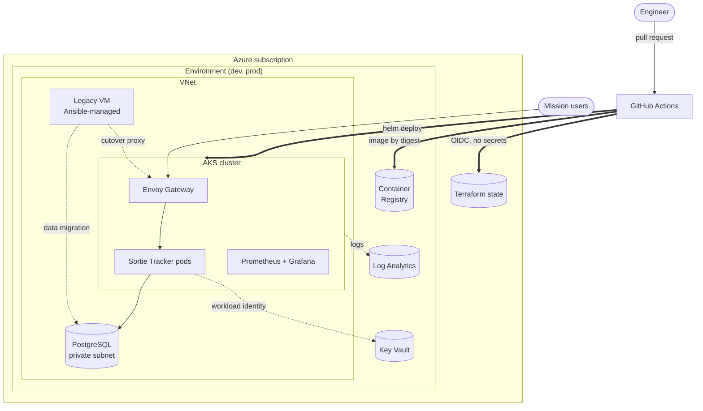

# Project HANGAR: mission app onboarding platform on Azure

A secure, automated platform for onboarding mission applications onto **Azure Kubernetes
Service**, demonstrated end to end. **Sortie Tracker**, a legacy Air Force-style
readiness API running on a hand-built VM, is hardened, migrated with verified data
integrity, and operated on AKS with SLOs, chaos-tested runbooks and AI-assisted
incident triage.

**Stack:** Azure · Terraform + Terragrunt · Docker · AKS + Helm · Envoy Gateway (Gateway API) ·
GitHub Actions · Ansible · Python · Bash · Prometheus/Grafana · Azure Monitor · Claude API

## At a glance

| | |
|---|---|
| 🔐 **No stored credentials anywhere** | CI → Azure via OIDC; pods → Key Vault via workload identity; DB passwords generated by Terraform straight into Key Vault |
| 🏗️ **Infrastructure as code** | 9 Terragrunt units × dev/prod, one state file each; Checkov: 0 failures, every exception justified inline |
| 📦 **Hardened supply chain** | Image: non-root, read-only FS, no pip, 0 fixable HIGH/CRITICAL CVEs; SBOM per build; actions pinned to SHAs; tool binaries checksum-verified |
| 🚚 **Safe delivery** | Build once, promote the same digest to prod behind an approval; Helm rollback on failure; smoke tests through the gateway |
| 🔁 **Rehearsed migration** | Every PR converges a legacy VM over SSH, migrates its database, detects a **single tampered row**, cuts over and rolls back |
| 💥 **Chaos-tested** | [Drill 001](docs/drills/postmortem-001-db-outage.md) found 6 issues; failed requests went from **5.0 s → 2.0 s** after the fix, verified by re-drill |
| 📈 **SLO-driven alerting** | Multi-window burn-rate alerts, **unit-tested with promtool**; every alert links a runbook |
| 🤖 **GenAI with guardrails** | Opt-in Claude triage agent: redacted aggregates only, read-only tools, 6-round cap, schema-constrained output |
| ✅ **67 automated tests** | + kind end-to-end platform test + Docker migration rehearsal, all in CI |

## Architecture



Request path, trust boundaries, pipeline and migration sequence diagrams:
**[docs/architecture.md](docs/architecture.md)**.

## How this maps to the DevOps Engineer role

| The role asks for | Where it is in this repo |
|-------------------|--------------------------|
| Operate and optimize cloud environments (Azure) | [`infra/`](infra/): AKS, PostgreSQL, Key Vault, ACR, VNet, Azure Monitor; dev/prod sizing in one file; [cost model](docs/cost.md) |
| Containers: Docker, Kubernetes | [`app/Dockerfile`](app/Dockerfile), [Helm chart](deploy/helm/sortie-tracker/), [platform add-ons](deploy/platform/), PSS `restricted`, NetworkPolicies, HPA/PDB |
| Scripting: Python, Bash | [`scripts/`](scripts/): data migration with checksums, cutover, chaos drills, log analyzer, AI triage |
| CI/CD with GitHub/GitLab | [`.github/workflows/`](.github/workflows/): 6 workflows, OIDC, environments, digest promotion ([ADR 0004](docs/adr/0004-ci-cd-pipeline.md)) |
| Infrastructure / configuration as code: Terraform, Terragrunt, Ansible | [`infra/`](infra/) modules + Terragrunt live config; [`ansible/`](ansible/) roles (CIS-style hardening, legacy app, cutover) |
| Troubleshoot distributed systems; analyze web app errors through logs | [Postmortem 001](docs/drills/postmortem-001-db-outage.md), [`log_analyzer.py`](scripts/log_analyzer.py), request tracing by `X-Request-ID`, [runbooks](docs/runbooks/README.md) |
| Develop onboarding paths for teams; migrate mission-critical capabilities | [Onboarding guide](docs/onboarding-guide.md), [migration runbook](docs/runbooks/migration.md), rehearsal in CI |
| *Nice to have:* Linux, networking, GenAI and agentic workflows | Host hardening with FIPS-approved SSH algorithms; subnet/NSG/NetworkPolicy design; [bounded Claude agent](docs/adr/0005-genai-incident-triage.md) |

## Run it

**Locally, no Azure account and no cost** (WSL2/Linux/macOS with Docker):

```bash
make prereqs                         # check the toolchain
make app-up app-seed                 # API + PostgreSQL at http://localhost:18080/docs
make k8s-local-e2e                   # kind: Envoy Gateway, PSS, NetworkPolicy, migrations, routing
make migration-rehearsal             # legacy VM → managed DB → cutover → rollback, in Docker
make chaos-drill-local SCENARIO=db-outage   # break it, measure it, read the findings
```

**On Azure** (about $0.18/hour for dev; see [cost](docs/cost.md)):

```bash
az login && make bootstrap           # state backend + GitHub OIDC identity
make infra-plan infra-apply ENV=dev  # ~20 min
make aks-credentials platform-install
make app-build acr-push deploy ENV=dev
scripts/cutover.sh migrate dev       # optional: run the legacy migration
make infra-destroy ENV=dev           # tear down
```

Every target: `make help`. Full walkthrough: [demo script](docs/demo-script.md).

## Verification status

Being explicit about what has been proven where:

| Verified | How |
|----------|-----|
| ✅ All Terraform modules validate; Terragrunt graph and HCL valid; Checkov clean | `make infra-validate infra-scan` |
| ✅ App: 31 unit + 4 PostgreSQL integration tests; schema-drift check | `make app-test app-test-integration` |
| ✅ Chart + platform on a real cluster (kind) under PSS `restricted` and enforced NetworkPolicies | `make k8s-local-e2e` |
| ✅ Migration end to end against a systemd VM over SSH; idempotence; tamper detection; cutover and rollback | `make migration-rehearsal` |
| ✅ Alert rules (promtool), analyzer and AI agent (26 tests, fake client) | `make alerts-test scripts-test` |
| ✅ Chaos drills: db-outage (4 runs, including the post-fix re-drill), bad-image, pod-kill, bad-client | [docs/drills/](docs/drills/) |
| ⏳ `terragrunt apply` against a real subscription; workload identity + Key Vault CSI on AKS; Azure Monitor alerts firing | Next step; `cutover.sh` and the CI workflows are written for it |
| ⏳ Live Claude API call | Needs `ANTHROPIC_API_KEY`; the agent loop is tested with a scripted client |

## Repository layout

```
bootstrap/        one-time Azure setup: state backend, GitHub OIDC identity
infra/            Terraform modules + Terragrunt live config (dev, prod)
app/              Sortie Tracker: FastAPI, SQLAlchemy, Alembic, tests, Dockerfile
deploy/           Helm chart · platform add-ons · deploy script · local kind e2e + drills
.github/          CI/CD workflows, composite actions, Dependabot
ansible/          roles, playbooks, dynamic inventory, Docker migration rehearsal
scripts/          migrate_db · cutover · chaos · log_analyzer · ai_triage · CI tooling
tests/prometheus/ promtool unit tests for alert rules
docs/             architecture · onboarding · runbooks · SLOs · drills · cost · demo · ADRs
```

## Documentation

| Doc | For |
|-----|-----|
| [Architecture](docs/architecture.md) | Diagrams, trust boundaries, security controls |
| [Onboarding guide](docs/onboarding-guide.md) | How a mission team brings an app onto the platform |
| [Runbooks](docs/runbooks/README.md) | One per alert, plus the [migration runbook](docs/runbooks/migration.md) |
| [SLOs](docs/slo.md) | SLIs, burn-rate alerting, error-budget policy |
| [Postmortem 001](docs/drills/postmortem-001-db-outage.md) | A chaos drill, its six findings and fixes |
| [Cost](docs/cost.md) | Per-environment estimates and levers |
| [Demo script](docs/demo-script.md) | 5-minute walkthrough and 15-minute live demo |
| [ADRs](docs/adr/README.md) | Five design decisions with trade-offs |
