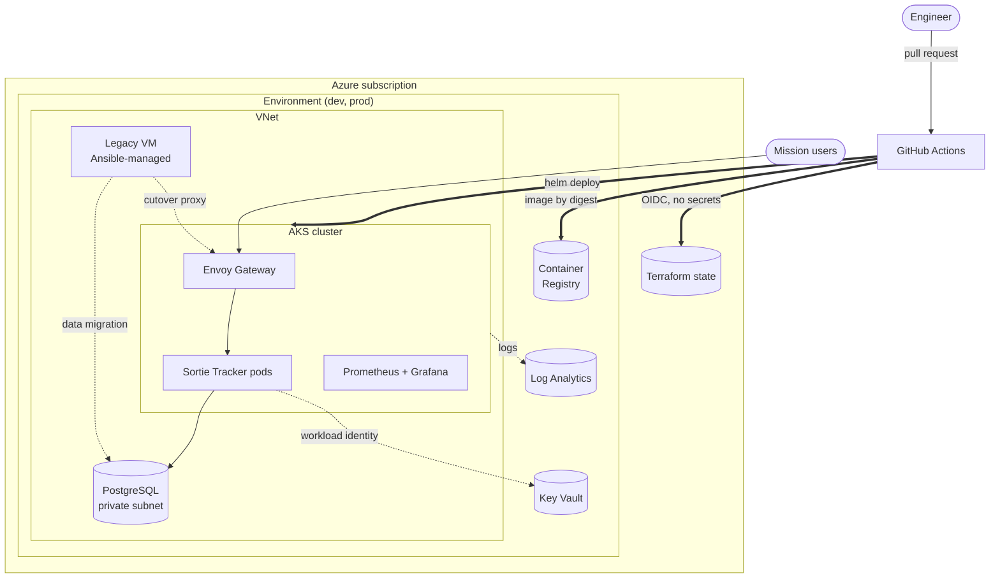
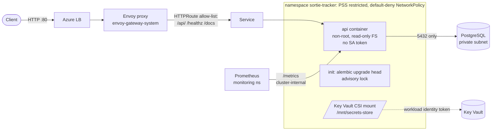
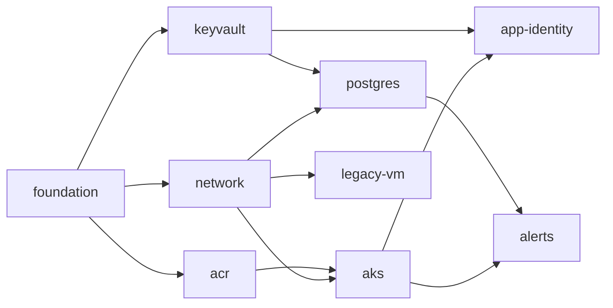
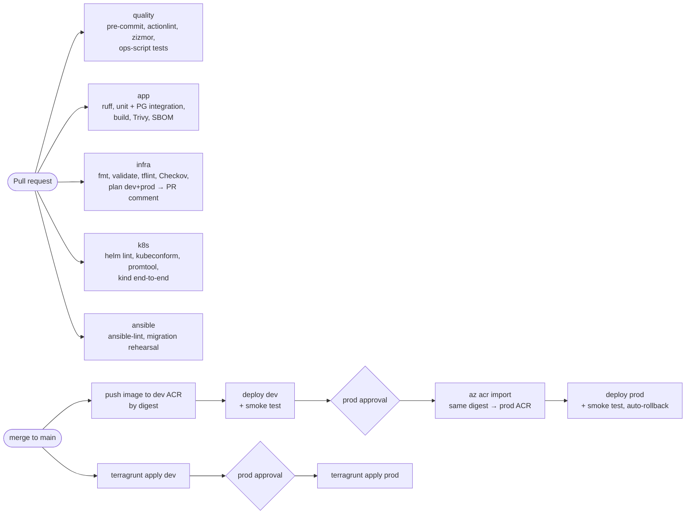
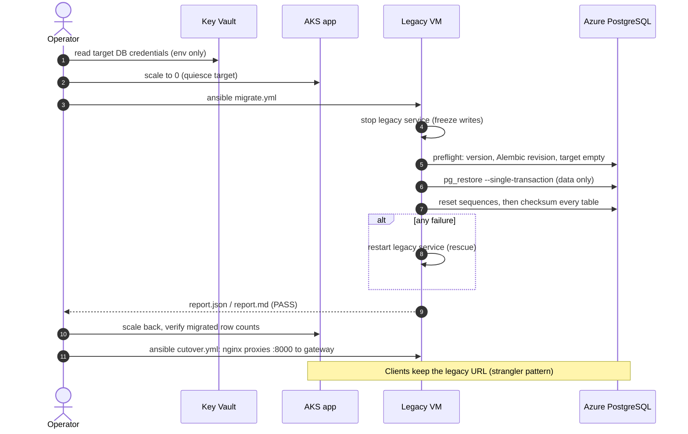
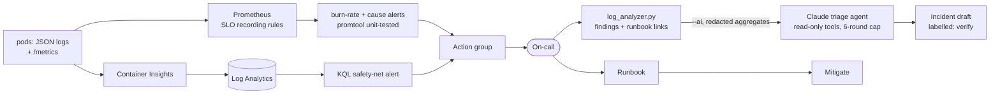

# Architecture

Project HANGAR is a platform for onboarding mission applications onto Azure. It is
shown end to end with one application, **Sortie Tracker**, moved from a hand-built
VM onto AKS. This document is the engineering view; the [README](../README.md) is
the summary.

- [1. System overview](#1-system-overview)
- [2. Request path and trust boundaries](#2-request-path-and-trust-boundaries)
- [3. Infrastructure as code](#3-infrastructure-as-code)
- [4. Delivery pipeline](#4-delivery-pipeline)
- [5. Legacy migration](#5-legacy-migration)
- [6. Observability and incident response](#6-observability-and-incident-response)
- [7. Security controls](#7-security-controls)
- [8. Design decisions](#8-design-decisions)

## 1. System overview

| Layer | Owner | Lives in |
|-------|-------|----------|
| Cloud foundation: network, registry, vault, database, cluster, alerts | Platform team | `infra/` (Terraform + Terragrunt) |
| Cluster platform: namespaces, gateway, monitoring | Platform team | `deploy/platform/` |
| Application: chart, SLOs, dashboard | App team | `app/`, `deploy/helm/sortie-tracker/` |
| Legacy host and migration | Platform + app team | `ansible/`, `scripts/migrate_db.py`, `scripts/cutover.sh` |

## 2. Request path and trust boundaries

- **Edge:** only the routes in the HTTPRoute allow-list are reachable. `/metrics` and `/readyz`
  return 404 from the internet (checked by every deploy's smoke test). Envoy preserves the
  caller's `X-Request-ID` or generates one, and the app logs it on every line.
- **Pod:** the `restricted` Pod Security profile is enforced. The pod runs as a non-root UID with a
  read-only root filesystem, all capabilities dropped, seccomp `RuntimeDefault`, and no
  Kubernetes API token mounted.
- **Identity:** the pod's service account is federated to a managed identity
  (`system:serviceaccount:sortie-tracker:sortie-tracker`), which may read secrets from one
  Key Vault. No credentials exist in the cluster, the image, Helm values or CI.
- **Network:** ingress comes only from the gateway and Prometheus namespaces; egress goes only to
  DNS and the PostgreSQL subnet. The internet is unreachable (verified by the kind e2e test).
- **Failure behaviour:** liveness never checks the database; readiness does. A DB outage drains
  traffic instead of restart-looping pods, and fails fast: the DB connect timeout (2 s) is below
  the probe timeout (3 s) ([postmortem 001](drills/postmortem-001-db-outage.md)).

## 3. Infrastructure as code

Nine Terragrunt units per environment, one state file each, wired by explicit
dependencies ([ADR 0002](adr/0002-terragrunt-unit-layout.md)):

| Unit | Builds |
|------|--------|
| foundation | Resource group, Log Analytics, alert action group |
| network | VNet; `aks`/`db`/`legacy` subnets with NSGs (db and legacy deny by default); PostgreSQL private DNS |
| acr | Private registry, admin user disabled, audit logs |
| keyvault | RBAC-mode vault, audit logs; purge protection in prod |
| aks | Entra-only auth (local accounts off), workload identity, Azure CNI Overlay + Cilium, KV CSI, Container Insights, audit logs, auto-patching |
| postgres | Flexible Server with VNet integration only; generated admin password written straight to Key Vault; connection auditing; zone-redundant HA in prod |
| app-identity | Managed identity + federated credential for the app's service account |
| legacy-vm | Ubuntu 24.04 VM (SSH keys only), tagged for Ansible's dynamic inventory |
| alerts | Azure Monitor alerts for the PaaS layer + a KQL app-error safety net |

Environment differences live in a single file per environment (`infra/live/<env>/env.hcl`): SKUs,
node counts, retention, HA. Every Checkov exception is justified inline; the accepted
trade-offs (public endpoints guarded by Entra ID, because CI uses GitHub-hosted runners)
are recorded in ADR 0002.

## 4. Delivery pipeline

- **No stored cloud secrets:** GitHub OIDC tokens are exchanged for Entra ID tokens. Plans
  authenticate as the pull request; applies and deploys as a GitHub Environment, so only an
  approved prod job can get a prod-capable token ([ADR 0001](adr/0001-github-oidc-federation.md)).
- **Build once, promote by digest:** prod runs the exact image that passed dev
  ([ADR 0004](adr/0004-ci-cd-pipeline.md)).
- **Supply chain:** actions pinned to commit SHAs, CLI tools verified against SHA-256 values
  committed in `scripts/ci/tool-versions.env`, service images pinned by digest, a CycloneDX SBOM
  per image, and Dependabot with a 14-day cooldown.

## 5. Legacy migration

The whole sequence is rehearsed on every PR in Docker (systemd VM over real SSH, Postgres,
the app image). The rehearsal checks idempotence (`changed=0`), refusal on a populated
target, detection of a single tampered row, cutover and rollback.
Procedure: [runbooks/migration.md](runbooks/migration.md).

## 6. Observability and incident response

- **SLOs** ([slo.md](slo.md)): 99% availability over 30 days, p95 under 500 ms. Multi-window,
  multi-burn-rate alerts page on fast burn and ticket on slow burn.
- **Chaos drills** (`scripts/chaos.sh`) rehearse each alert's failure mode. Drill 001 found six
  issues; four were fixed and re-verified the same day ([postmortem](drills/postmortem-001-db-outage.md)).
- **GenAI triage** is opt-in and bounded ([ADR 0005](adr/0005-genai-incident-triage.md)): the
  deterministic analyzer is the source of truth, and the model drafts the write-up.

## 7. Security controls

| Area | Control | Where |
|------|---------|-------|
| Identity | No stored cloud credentials: OIDC for CI, workload identity for pods, managed identity for kubelet→ACR | `bootstrap/setup-oidc.sh`, `infra/modules/aks`, `workload_identity` |
| Least privilege | CI may assign only 7 named roles (ABAC-conditioned RBAC Administrator), never Owner | ADR 0001 |
| Secrets | Generated by Terraform into Key Vault; mounted by CSI; never in git, images, values or logs | `infra/modules/postgres`, chart `secretproviderclass.yaml` |
| Data plane | Private DB (no public endpoint), TLS enforced, Entra-only state storage, shared keys disabled | `postgres`, `bootstrap-tfstate.sh` |
| Network | Segmented subnets with NSGs; default-deny NetworkPolicy; HTTPRoute allow-list | `network`, chart |
| Workload | PSS `restricted`; non-root; read-only FS; no capabilities; no pip in the image | chart, `app/Dockerfile` |
| Hosts | CIS-style baseline, SSH with FIPS-approved algorithms, auditd, ufw, consent banner | `ansible/roles/baseline_hardening` |
| Supply chain | SHA-pinned actions, checksum-verified tools, Trivy gate, SBOM, Dependabot | `.github/`, `scripts/ci/` |
| Policy as code | Checkov (Terraform, Kubernetes, Dockerfile, Actions), tflint, ansible-lint, zizmor, gitleaks | CI |
| Audit | Key Vault, ACR, AKS (`kube-audit-admin`), PostgreSQL logs → Log Analytics | Terraform diagnostic settings |

## 8. Design decisions

| ADR | Decision |
|-----|----------|
| [0001](adr/0001-github-oidc-federation.md) | GitHub Actions authenticates to Azure with OIDC federation |
| [0002](adr/0002-terragrunt-unit-layout.md) | Terragrunt units per component, one state file per unit |
| [0003](adr/0003-gateway-api-and-migrations.md) | Gateway API for ingress; init-container migrations with an advisory lock |
| [0004](adr/0004-ci-cd-pipeline.md) | CI/CD: build once, promote by digest, gate prod |
| [0005](adr/0005-genai-incident-triage.md) | GenAI incident triage as a bounded, read-only agent |
